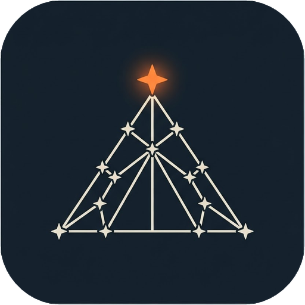
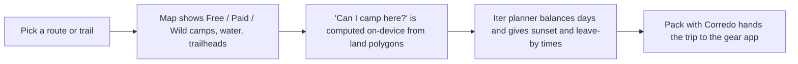

  
  <h1>Stellata</h1>

  
<strong>Find your night under the stars.</strong>

     

> **Showcase repository.** The source code for Stellata is not published. This page presents what the product is and how it works.

## Overview

AllTrails shows you the trail; Stellata shows you where to sleep on it. A backpacking app that maps free, paid and wild camping along routes, built so a beginner can plan and finish a first overnight trip.

## How it works

## Features

- Map of free, paid and wild (dispersed) camping with trails, trailheads and wild zones
- "Can I camp here?" answers from land rules; unknown is never "yes"
- Iter trip planner with NWS forecast, gear checklist and shareable safety plan
- First Trip (Tenda) beginner questionnaire and recommendations
- GPS hike recording, summaries, moderated trip reports
- Offline maps, Sign in with Apple backup, report/block moderation
- Pack with Corredo deep link (corredo://trip)

## Tech stack

| Layer | Choice |
|---|---|
| Language / UI | Swift 6, SwiftUI, iOS 18+ |
| Backend | Supabase (Postgres + PostGIS, RLS, Auth, Storage, Edge Functions) |
| Maps | MapLibre Native + OpenFreeMap tiles (OSM) |
| Data | USFS, NPS, Recreation.gov, OpenStreetMap |
| Tests | Swift Testing + accessibility audit UI tests |

## Privacy & security

GPS position never leaves the phone. RLS on every table; shared wild-spot pins are fuzzed 100–250 m. Account and online data deletable in one step.

## Brand

| | Name | Hex | Role |
|---|---|---|---|
|  | Night | `#16202A` | Primary dark |
|  | Canvas | `#F4F1EA` | Light surface |
|  | Ember | `#E8893C` | Accent |
|  | Pine | `#2A7353` | Free / success |
|  | Lake | `#24466F` | Water / info |

**Mark.** Constellation drawn as a tent with an ember-orange star at the apex, on a night-blue field.

**Voice.** Encouraging and practical, written for beginners. Never promises legality: says "check local rules" when unsure.

## Roadmap

- Missed-check-in alerts (needs SMS/email provider)
- More regions beyond the Indian Peaks & Wild Basin pilot
- Aestiva Pro subscription
- Android
- Device and VoiceOver testing

## Notes

Pilot region: Indian Peaks & Wild Basin (54 camps, 75 trails, 17 trailheads, 28 water sources). Debug builds use fictional sample data labelled as such. Companion app: [Corredo](https://github.com/Steven6Brown/Corredo).

## License

Proprietary. Shared publicly for portfolio and demonstration purposes only. See [LICENSE](LICENSE).

---

Built by [Aquila Digital LLC](https://github.com/Steven6Brown) · *Per Aspera Ad Astra*

